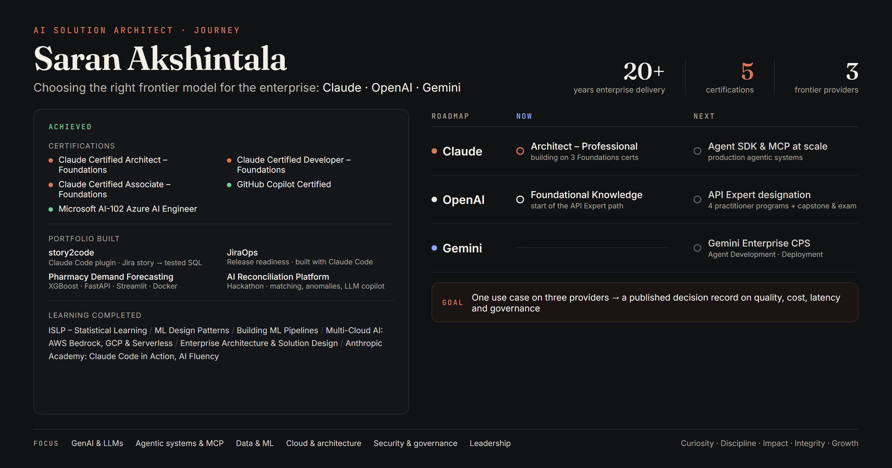

  

# 👋 Hello, I'm Saran Akshintala

## 🚀 AI Solution Architect · Claude, OpenAI & Gemini · Agentic Systems & MCP

Enterprise technology leader with **20+ years of delivery** across global banking, insurance and data platforms, now designing practical AI systems: LLM integrations, retrieval-augmented generation (RAG), agent workflows and **Model Context Protocol (MCP)** tooling.

My depth is in **Anthropic Claude**, and I'm building working fluency in **OpenAI** and **Google Gemini** so I can help organizations choose the right model provider for each use case, weighing quality, cost, latency, data governance and operational risk.

I combine deep enterprise experience (requirements, governance, delivery, teams of up to 30+) with hands-on AI engineering, and I build in public.

---

## 🏆 Certifications

- 🟠 **Claude Certified Architect – Foundations** (Anthropic, 2026)
- 🟠 **Claude Certified Developer – Foundations** (Anthropic, 2026)
- 🟠 **Claude Certified Associate – Foundations** (Anthropic, 2026)
- 💻 **GitHub Copilot** (GitHub, 2025)
- ☁️ **Microsoft Certified: Azure AI Engineer Associate (AI-102)** (2024)

---

## 🛠️ What I've Built

| Project | What it does | Stack |
|---|---|---|
| **story2code** | Claude Code plugin that turns a Jira story into SQL code and a unit-test script. Plan-first, developer-in-the-loop, read-only by design, with tamper-evident test evidence. | Claude Code, plugins |
| **JiraOps** | Release-readiness and Jira hygiene checks against Azure DevOps deployments; drafts follow-up messages for review. Built with Claude Code. | Claude Code, Jira & Azure DevOps APIs |
| [**Pharmacy Demand Forecasting**](https://github.com/Saran-Akshintala/pharm-demand-ops) | End-to-end order-quantity prediction with real business rules (box sizes, stock, expiry, promotions). | XGBoost, FastAPI, Streamlit, Docker |
| [**AI Reconciliation Platform**](https://github.com/Saran-Akshintala/ai-recon-platform) | Hackathon project: layered matching (exact, fuzzy, ML), anomaly detection and an LLM copilot for financial data. | Python, scikit-learn, Streamlit, LLM |

*story2code and JiraOps are workplace tools, so their code is not public.*

## 📚 Learning Completed

- 🤖 ISLP – Statistical Learning Foundations
- 🏗️ Machine Learning Design Patterns
- ⚙️ Building Machine Learning Pipelines
- ☁️ Multi-Cloud AI Foundations – AWS Bedrock, GCP & Serverless
- 🏛️ Enterprise Architecture & Solution Design Foundations
- 📊 Data Foundations and Data Architecture
- 🎓 Anthropic Academy: Claude 101, Claude Code 101, Claude Code in Action, AI Fluency, AI Capabilities and Limitations

---

## 🗺️ Multi-Provider Roadmap

| Provider | Status | Path |
|---|---|---|
| 🟠 **Anthropic Claude** | ✅ 3 certifications · 🚧 Architect – Professional in progress | Associate → Developer → Architect (Foundations) → Architect (Professional) |
| ⚪ **OpenAI** | 🚧 Started | API Expert: Foundational Knowledge → Technical Practitioner → API Deployment → Codex Deployment → Consultative Solutions → Capstone & exam |
| 🔵 **Google Gemini** | 💤 Planned | Gemini Enterprise Certified Partner Specialist: Agent Development → Deployment |

**Next project:** build one realistic use case on Claude, OpenAI and Gemini behind a common interface, evaluate them side by side (quality, cost, latency, tool use, governance), and publish the decision record.

## 🎯 Current Focus

- 🤖 GenAI & LLMs: Claude API, Claude Agent SDK and Claude Code
- 🔌 Agentic systems and MCP servers
- ⚖️ Comparing frontier model providers for enterprise use
- 📊 Data & ML, RAG and LLM evaluation
- ☁️ Cloud & architecture
- 🔐 Security, governance and responsible AI
- 🤝 Leadership and executive communication

## 🧭 Guiding Principles

**Curiosity** (keep asking questions) · **Discipline** (consistency compounds) · **Impact** (solve meaningful problems) · **Integrity** (do the right thing) · **Growth** (never stop learning) · **Collaboration** (rise by lifting others)

## ⭐ AI Solution Architect Mission Dashboard

Track my public progress through projects, certifications across Claude, OpenAI and Gemini, and architecture practice.

🔗 **Live Dashboard:** https://github.com/users/Saran-Akshintala/projects/2/views/1

---

## 🌱 Beyond Work

I enjoy learning practical technology and solving real-life problems: educational YouTube content (Rishi Kushi), video editing, IoT/Arduino experiments, automation tools and app prototyping.

---

## 🤝 Open to Collaborate On

- Enterprise AI use cases and Claude, OpenAI or Gemini integrations
- Model-provider evaluation and selection
- AI / automation ideas and productivity tools
- Data / ML prototypes

## 📫 Contact

📧 **Saran.Akshintala@outlook.com** · 💼 [LinkedIn](https://www.linkedin.com/in/saran-akshintala)
